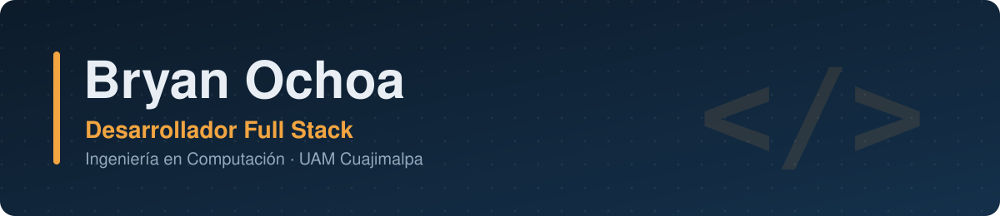
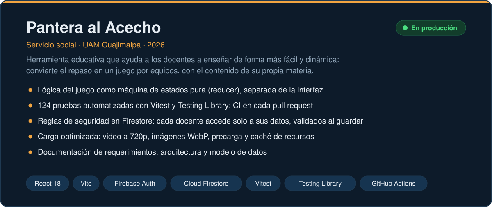
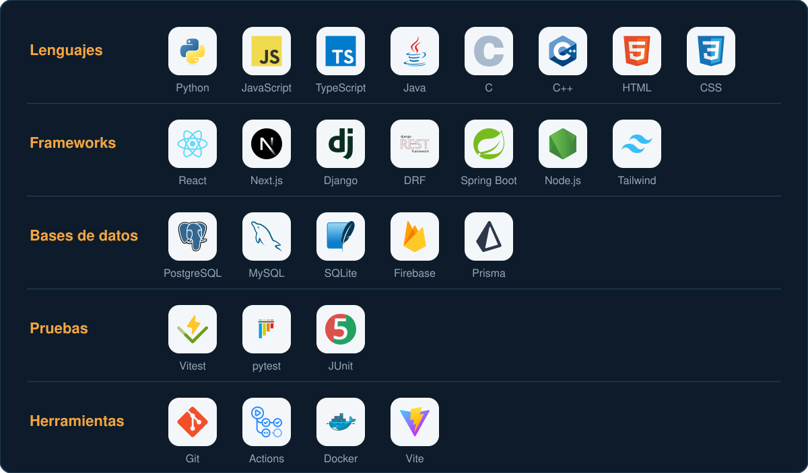

  

  
  

## Sobre mí

Desarrollador full stack. Construyo aplicaciones web completas: interfaz, API, base de datos y despliegue, con pruebas automatizadas y documentación.

📍 Ciudad de México · Abierto a oportunidades

## Proyecto destacado

  
  

## Stack

  

